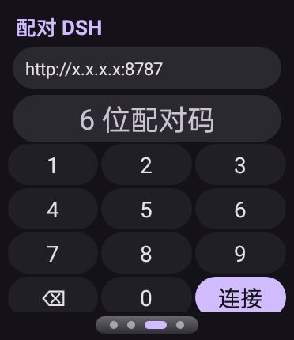
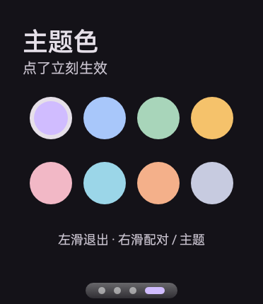
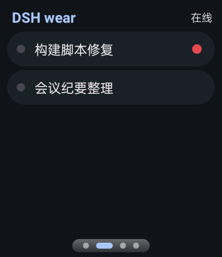

# DSH wear

A wrist-sized client for [DeepSeek Harness](https://github.com/deepseek-ai/deepseek-harness):
see what the agent is doing, approve permission prompts, answer its questions, and
stop a runaway turn — from a smartwatch.

- **`dsh-watch-bridge`** — a zero-dependency Cordis plugin for a DSH profile. It
  listens on a port, pairs a device with a one-time code, and exposes a small JSON API.
- **`dsh-watch.apk`** — a ~29 KB Android app (minSdk 21), built entirely in code with
  framework widgets, for 1.8" screens. Verified on an OPPO Watch 2 (Android 8.1, 372×430).

The pairing code is never rendered on a web page and never printed to the log:
you ask the agent for it and it calls the `watch_pair_code` tool.


<br>




<br>


<sub>四页横滑：退出 ← 对话 → 配对 → 主题。底部玻璃胶囊显示当前页。</sub>



## Quick start (English)

```bash
# 1) on the machine that runs DSH
./install.sh

# 2) in a DSH conversation, ask: "give me the watch pairing code"
#    the agent calls watch_pair_code and hands you a 6-digit code

# 3) on the watch
adb install -r dsh-watch.apk
adb shell am start -n io.dsh.watch/.MainActivity \
  --es url http://<server-ip>:8787 --es code <code>
```

The watch keeps the URL and token after pairing; the gear icon in the list screen
re-opens pairing when the server address changes.

---

手表上看 DSH：当前任务、最近几条回复、**权限确认**，抬手就能点。

- **插件** `dsh-watch-bridge` —— 装在跑 DSH 的机器上（阿里云服务器 / 手机本机都行），对外开一个小 HTTP 服务，配对码换 token。
- **手表 App** `dist/dsh-watch.apk` —— Android 5.0+，为 1.8 寸小屏设计（OPPO Watch 2 实测 372×430），自带数字键盘（手表没有输入法也能配对），包名 `io.dsh.watch`。

---

## 一分钟版

```bash
# 1) 在跑 DSH 的机器上
./install.sh                       # 装插件 + 写配置
# 2) 在 DSH 对话里说「给我手表配对码」，助手会把码发给你
# 3) 手表上装 APK 并直接配对
adb install -r dist/dsh-watch.apk
adb shell am start -n io.dsh.watch/.MainActivity \
  --es url http://<那台机器>:8787 --es code 123456
```

配对一次就记住了，之后打开就是会话列表。

---

## 一、装插件

插件就是本目录，`install.sh` 会做三件事：把目录拷到 `~/dsh-watch-bridge`、`dsh plugin add` 进 profile、往 `cordis.patch.yml` 追加一行。

### 阿里云服务器

```bash
scp -r dsh-watch-bridge root@<服务器>:/root/
ssh root@<服务器>
cd /root/dsh-watch-bridge && ./install.sh
```

然后：

1. **阿里云安全组**放行 TCP `8787`（入方向）。想低调点就改端口，见下面「配置」。
2. 确认能连通：
   ```bash
   curl -s http://127.0.0.1:8787/health
   # {"ok":true,"version":"0.2.0","devices":0,...}
   ```
3. `/watch` 页面只剩地址、APK 下载和已配对设备——**配对码不在上面**，只在对话里要。

> 插件和 DSH 同一个进程，`dsh web` 重启后自动跟着起来，不需要额外守护进程。
> 如果引擎没有热加载，重启一次 `dsh web` 即可。

### 手机本机（dsh-go）

手机上的 DSH 引擎在 proot 里，插件一样装：

```bash
cd /root/workspace/dsh-watch-bridge && ./install.sh
```

装完在 DSH 对话里说「给我手表配对码」，助手调用 `watch_pair_code` 把码和地址给你。
同一个 Wi-Fi 下的手表连 `<手机内网IP>:8787`（页面会列出所有可用地址）。

---

## 二、装手表 App

### 安装

实测手表：**OPPO Watch 2 42mm · Android 8.1 (SDK 27) · 372×430 px · 320dpi = 186×215dp**。
这个尺寸下界面是刚好够用的（配对页要滚一下才看到「连接」）。

```bash
adb connect 192.168.3.24:5555      # 手表的无线调试端口，第一次要在表上点「允许」
adb install -r dist/dsh-watch.apk
```

OPPO Watch 2 需要在开发者选项里打开「USB 调试 / 无线调试」。装完桌面上叫 **DSH wear**。

### 配对（三种方式，任选）

配对码从 DSH 对话里拿（问助手「给我手表配对码」）。它是密钥：不进网页、不进日志、不主动弹出。

**① 一条命令搞定（推荐）**

```bash
adb shell am start -n io.dsh.watch/.MainActivity \
  --es url http://192.168.3.48:8787 --es code 123456
```

App 会自己配对并把地址和 token 存下来。

**② 推一个配置文件**

```bash
echo '{"url":"http://192.168.3.48:8787","code":"123456"}' > dshwatch.json
adb push dshwatch.json /sdcard/dshwatch.json
```

App 冷启动时读 `/sdcard/dshwatch.json`，读到了就自动配对。

**③ 手表上手输**

打开 App → 地址栏（默认 `http://`）→ 用自带的数字键盘敲 6 位配对码 → 「连接」。
地址栏要改的话需要输入法；没有输入法就用 ① 或 ②，别硬敲。

### DPI

```bash
adb shell wm density 240        # 402x476 → 268x317dp，字和按钮都变大
adb shell wm density 280        # 更极限，信息更多但更难按
adb shell wm density reset      # 恢复
```

App 全部用 dp/sp 排版，改 DPI 不会错位。

---

## 三、手表上能干什么

四页横向滑动，底部有玻璃胶囊指示器（当前页拉长）：

| 页面 | 内容 |
|---|---|
| **退出**（最左） | 继续使用 / 退出应用，防止误触右滑把 App 关掉 |
| **对话**（默认） | 会话列表 → 点进去看详情 |
| **配对** | 服务器地址 + 6 位配对码（自带数字键盘） |
| **主题** | 8 套配色，点了立刻生效并记住 |

| 屏幕 | 内容 |
|---|---|
| 会话列表 | 标题、绿点=运行中、红点=待确认、右边红色数字是待确认条数；**刚跑完的会话右边有红点**（点进去消失），并发一条通知给桌面角标 |
| 会话详情 | 最近 8 条消息（你 / DSH）、当前正在跑的工具名 |
| 审批卡片 | 「需要确认 · 工具名」+ 原因 + 命令原文 + **允许 / 拒绝**（点完立刻生效，震动提醒） |
| 提问卡片 | DSH 的 `ask_user_question`：选项直接点，单选题一下就走 |
| 底部条 | 停止（带确认）、说一句（4 个快捷语 / 自定义）、待确认跳转 |
| 右上角 | `审批 开 / 审批 关` —— 直接切这个会话的审批策略（`ask` / `never`） |
| 退出 | 左滑到退出页，或按返回键；不会误触直接杀掉 |

**关于「审批 关」**：会话被切成 `never` 之后，DSH 根本不会再发审批请求（自动拒绝），所以手表上什么都看不到。你之前遇到的「有时候没看到确认」如果是因为策略被关掉了，手表上直接点开就行。

### 提醒

- 有新审批时手表会**震动**（App 在前台、4 秒一轮）。
- 手表息屏/退出 App 后不再轮询；后台常驻通知要另做（见「还没做的」）。

---

## 四、配置

`~/.dsh/profiles/web/cordis.patch.yml` 里那一行：

```yaml
- insert:
    - id: watch-bridge
      name: dsh-watch-bridge
      config:
        port: 8787            # 对外端口
        host: '0.0.0.0'       # 想只给内网就写具体 IP，比如 192.168.3.48
        relayApprovals: true  # 是否把审批推到手表
        relayQuestions: true  # 是否把 ask_user_question 推到手表
        approvalWaitMs: 120000 # 没有网页端时，等手表最多多久
        questionWaitMs: 300000
        name: 'orange-cloud'  # 显示在手表上的名字（默认主机名）
        stateDir: '~/.dsh/watch-bridge'  # 设备表存放位置
        logLevel: info
```

改完保存，引擎会自动重载这一行（几秒）。

命令行随时拿码：

```bash
curl -s http://127.0.0.1:8787/api/selftest | jq   # 诊断：服务在不在、哪些会话是活的、审批策略
```

配对码只能通过对话拿（`watch_pair_code` 工具），没有任何 HTTP 接口或页面会显示它。

---

## 五、API（给别的屏幕用）

除 `/api/hello`、`/api/pair` 外都要 `Authorization: Bearer <token>`。

| 方法 | 路径 | 说明 |
|---|---|---|
| GET | `/api/hello` | 未配对也能调，返回服务名和是否已配对 |
| POST | `/api/pair` | `{code,name}` → `{token}`，配对码一次性 |
| GET | `/api/state?session=<id>&limit=8` | 一把梭：会话列表 + 指定会话的消息 + 待处理 |
| GET | `/api/sessions` | 只有会话列表 |
| GET | `/api/pending` | 所有待确认 |
| POST | `/api/approve` | `{id,allow:true|false}` |
| POST | `/api/answer` | `{id,answers:[{id,selected:[],custom}]}` |
| POST | `/api/say` | `{session,text}`，运行中自动 steer，空闲时排队 |
| POST | `/api/stop` | `{session}` |
| POST | `/api/policy` | `{session,policy:"ask"|"never"}` |
| GET | `/api/selftest` | 仅本机，排障用 |
| POST | `/api/devices/revoke` | 仅本机，`{id}` 撤销一台设备 |
| POST | `/api/debug/approval` | 仅本机且 `allowDebug: true`，造一条假审批用来调界面 |
| GET | `/watch` | 配对页（HTML） |
| GET | `/dsh-watch.apk` | 下载手表 App |

`/api/state` 的返回里，`session.messages[].role` 是 `u`（你）或 `a`（DSH）；`session.pending[]` 里 `kind` 是 `approval` 或 `question`。

---

## 六、安全（认真看这段）

### 这个桥接的权限等价于什么

拿到 token 的人可以：看你的会话内容、**批准任意命令执行**、往会话里发指令、停任务、改审批策略。
DSH 的 agent 有 shell，所以「能批准命令」≈「能在那台机器上执行命令」。请按 **ssh 私钥** 的级别对待 token。

### 已经做的

| 项 | 现状 |
|---|---|
| 配对码 | 6 位，10 分钟过期，**错 5 次立刻作废换新码**，一台设备一份 token |
| token | 48 位随机十六进制，服务端只存 sha256，`devices.json` 600 权限 |
| 配对码 | **只能通过对话里的 `watch_pair_code` 工具拿**；网页、日志、HTTP 接口都不显示 |
| 配对页 `/watch` | 只有本机打开才列设备（可撤销）；远程只给提示页，从来不含配对码 |
| 反代 | 请求带 `X-Forwarded-For` / `X-Real-IP` / `Forwarded` 时**一律当作非本机**，防止 nginx 把本机接口暴露成公网接口 |
| DNS rebinding | 本机接口还要求 `Host` 是 IP 字面量或 `localhost`，恶意网页解析到 127.0.0.1 也调不动 |
| 慢速攻击 | 服务器设了 header/request/keepalive 超时 |
| token 泄露面 | **不接受 `?token=` 查询参数**（会进代理日志和 Referer） |
| 撤销 | `/watch` 页面上点「撤销」，或 `curl -X POST 127.0.0.1:8787/api/devices/revoke -d '{"id":"..."}'` |

### 还没解决 / 需要你决定的

1. **默认明文 HTTP**。公网上跑，token 在链路上裸奔，中间人抓到就能冒充你的表。三个选择：
   - 插件已支持 TLS，给证书就行（见下面「配置」里的 `tlsCert` / `tlsKey`）；
   - 或者前面挡一层 nginx + 证书（记得保留 `X-Forwarded-For`，本机接口会自动锁死）；
   - 或者根本别对公网开，用 WireGuard / Tailscale / SSH 隧道。
2. **安全组别放 0.0.0.0/0**。能限定来源就限定（手表用 eSIM 时 IP 会变，做不到就至少换非默认端口）。
3. **配对码已经不进日志了**：只有你主动问助手时才会出现在对话里。别把那段聊天截图发出去。
4. **手表丢了**：马上撤销那台设备；App 里存的 token 没有额外加密（靠 Android 应用沙箱）。
5. **APK 下载走明文**：`/dsh-watch.apk` 是公开链接，中间人换包的话…… 反正你要 adb 装，装之前对一下签名：
   `apksigner verify --print-certs dsh-watch.apk`，SHA-256 应该是 `37351afc0845826d1b3b5dcddbe50875e2b29560a43d1f850860e099151f8aac`。
6. **`android/keystore.jks`（口令 dshwatch）**：用来签更新包的私钥。别公开分发这个文件，否则别人能签一个假升级包。打包脚本已经把它排除在 tar.gz 之外。

### 一句话建议

服务器挂在公网就用 TLS + 非默认端口 + 安全组限源；懒得折腾就 Tailscale，最省心。

## 七、排障

| 现象 | 先看 |
|---|---|
| 手表连不上 | 服务器上 `curl 127.0.0.1:8787/health`；再看安全组/防火墙；手机同 Wi-Fi 就试 `http://<内网IP>:8787/health` |
| 401 | token 被清了或换了 `stateDir`，重新配对（对话里要码） |
| 列表是空的 | `/api/selftest` 看 `sessionQuery` 在不在；`sessions` 目录有会话吗 |
| 审批没推过来 | `/api/selftest` 看该会话 `policy` 是不是 `never`；手表 App 是不是在前台（3 分钟内有过请求才算在线） |
| 点「允许」没反应 | 审批可能已经被网页端点了，或者在手表收到之前就超时了 |
| 装不上 APK | `adb install -r` 加 `-d` 降级？确认 targetSdk 27 不被系统拦；手表空间够 |
| 打开黑屏 | 0.1.1 起内部异常会直接显示在屏幕上；还黑就抓日志：`adb logcat -d \| grep -iE "DSHWatch\|AndroidRuntime\|io.dsh.watch"` |
| 界面元素挤在一起 | 调 DPI：`adb shell wm density 240` |
| 手机/服务器换 IP 了 | App 里点右上角 ⚙ → 改地址 → 重新配对（地址是配对时存下来的） |
| 手表连不上手机 | 手机 IP 会变（DHCP）。在手机上 `ip addr` 或看 `/watch` 页面列的地址；另外路由器若开了 AP 隔离，手表到手机的反向连接会被挡 |

---

## 八、还没做的

- 后台常驻通知（手表息屏也能震）—— 需要前台服务 + 通知渠道，等你说要不要。
- `/watch` 页面里改端口（现在只能改配置文件）。
- 手表上翻更早的消息（现在固定最后 8 条）。
- 多问一题的 `ask_user_question` 目前只提交选中的那一题。

## 九、目录

```
dsh-watch-bridge/
├── lib/index.js            # 插件本体（零依赖，只 import node 内置模块）
├── cordis.patch.yml        # 插件行模板
├── dist/dsh-watch.apk      # 手表 App
├── android/                # App 源码 + 构建脚本（aapt2 + javac + d8，不用 Gradle）
├── install.sh              # 一键装插件
└── package.sh              # 打 tar.gz
```
