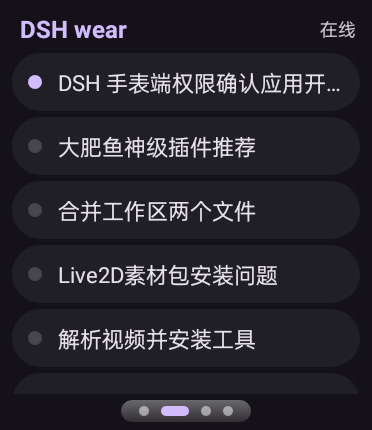
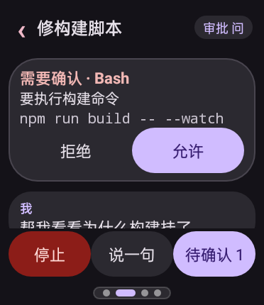
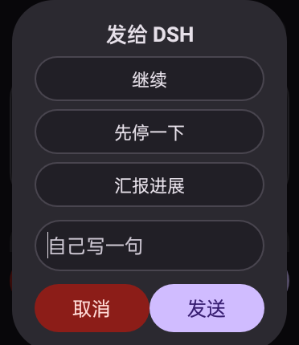
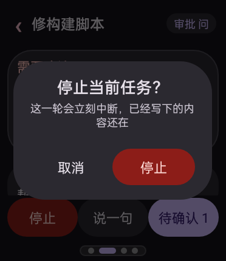
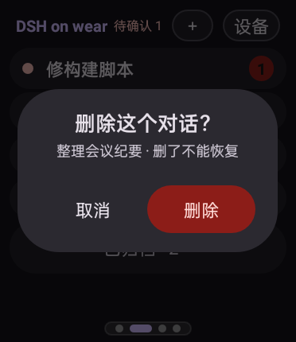
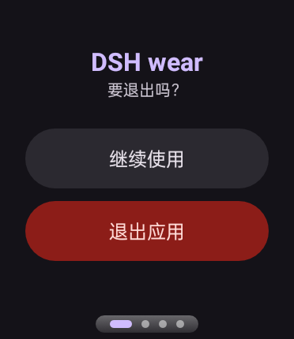

# DSH on wear

> **本项目由 AI 生成。** 从代码、界面到文档，全部由 AI 在对话里写出来，人只提需求和验收。
> 它会把你的会话内容和审批权限交给一块手表 App，用之前请读 [SECURITY.md](SECURITY.md)。
>
> **This project is AI-generated.** Code, UI and docs were written by an AI in conversation. Read [SECURITY.md](SECURITY.md) before using it.

在手表上看 DeepSeek Harness：当前任务在跑什么、最近几条回复、**权限确认**、提问，抬手就能点。
配套一个零依赖的 Cordis 插件，装在跑 DSH 的那台机器上（电脑 / 云服务器 / 手机都行）。

- **`dsh-watch-bridge`** —— DSH 插件，开一个小 HTTP 服务，一次性配对码换长期 token。
- **`dsh-watch.apk`** —— 45 KB 的 Android 手表 App，纯 framework 控件，不用 AndroidX，minSdk 21。
  在 OPPO Watch 2（Android 8.1，372×430）上验证过。

## 界面

| 会话列表 | 会话详情 / 审批 |
| --- | --- |
|  |  |

| 配对 | 主题色 |
| --- | --- |
|  |  |

| 发一句话 | 停止确认 |
| --- | --- |
|  |  |

| 长按删除 | 退出页 |
| --- | --- |
|  |  |

四页横滑：**退出 ← 对话 → 配对 → 主题**，底部一枚透明胶囊指示当前页。
（截图里是演示数据，不是真实会话。）

## 一条命令装好

在跑 DSH 的那台机器上：

```bash
git clone --depth 1 https://github.com/chen1ncx/dsh-wear.git ~/dsh-wear && cd ~/dsh-wear && ./install.sh
```

脚本会：把插件拷到 `~/dsh-watch-bridge`、`dsh plugin add` 进 profile、往
`~/.dsh/profiles/web/cordis.patch.yml` 追加一段配置，然后等端口起来。
想换端口：`WATCH_PORT=9000 ./install.sh`。换 profile：`DSH_PROFILE=tui ./install.sh`。

装完重启一次 DSH（同一个进程里加载插件），再看：

```bash
curl -s http://127.0.0.1:8787/api/hello
# {"ok":true,"protocol":1,"version":"0.2.2",...}
```

### 装到手表

```bash
# 下载 release 里的 apk，或者自己构建（见下）
adb install -r dsh-watch.apk
```

然后**在 DSH 对话里说「给我手表配对码」**，助手会调 `watch_pair_code` 把 6 位码给你
（配对码不会出现在网页和日志里，只有你问才会给，10 分钟有效）。

手表上：进配对页 → 填地址 `http://192.168.0.1:8787`（换成你那台机器的局域网/公网 IP）
→ 数字键盘输码 → 连接。之后地址和 token 都记在手表里，不用再配。

服务器在别的网段就改安全组/防火墙放行端口；想低调就换端口 + 只放行自己的 IP。

## 手表上能做什么

- **看列表**：谁在跑（绿点）、谁有待确认（红点 + 数字）、归档的折进「已归档 · N」一行。
- **看对话**：最近几条消息，卡片式，滑到底自动跟。
- **批权限**：工具要权限时直接弹卡片，`拒绝` / `允许`，跟网页端抢答，谁先点算谁的。
- **答提问**：`ask_user_question` 的问题和选项也在手表上点。
- **发一句**：`继续` / `先停一下` / `汇报进展` 三个快捷键，或者自己打一句。
- **停**：停止按钮有确认，避免误触。
- **新建**：顶栏 `＋`，在当前会话的目录里开一个新对话。
- **长按删除**：长按任意会话 → 确认卡 → 删掉（DSH 侧不可恢复）。
- **自动通过**：详情页的「审批 问」可以切成「自动通过」，这个会话的权限确认不再逐条问你。
- **换服务器**：顶栏「设备」列出配对过的机器，一点就切；长按可以删掉某一台。
- **任务跑完**：列表里亮红点 + 通知，抬手就知道。

## 插件源码在哪里

| 东西 | 位置 |
| --- | --- |
| 插件源码 | [`lib/index.js`](lib/index.js)（单文件，零依赖） |
| 插件配置 | [`cordis.patch.yml`](cordis.patch.yml) |
| 手表 App 源码 | [`android/src/io/dsh/watch/MainActivity.java`](android/src/io/dsh/watch/MainActivity.java)（单文件） |
| 构建脚本 | [`android/build.sh`](android/build.sh)（aapt2 + javac + d8，不用 Gradle） |
| 安装脚本 | [`install.sh`](install.sh) |
| 发布包 | [Releases](https://github.com/chen1ncx/dsh-wear/releases) |

改完插件不用重新打包 APK：手表连的是插件，插件升级只要替换 `lib/index.js` 再重启 DSH。

## 自己构建 APK

需要 `aapt2`、`zipalign`、`apksigner`（apt 的 `aapt` / `android-sdk-build-tools`）和
`d8.jar`（Google build-tools 34，放 `/opt/android-sdk/build-tools/34.0.0/lib/d8.jar`）。

```bash
cd android && ./build.sh     # 产出 ../dist/dsh-watch.apk
```

第一次构建会用 `keytool` 生成 `android/keystore.jks`（口令 `dshwatch`）。**这个文件别外传**：
拿到它就能签一个假升级包。`.gitignore` 已经排除，发行包里也没有。

## 安全

看 [SECURITY.md](SECURITY.md)。要点：

- 配对码只在对话里出现，网页和日志都不渲染。
- token 是 48 位随机串，服务端只存 sha256，可在「设备」里撤销。
- 管理接口只允许本机访问，带 Host 头校验，防 DNS rebinding。
- 走公网的话建议 TLS + 非默认端口，或者干脆 Tailscale。

## English quick start

```bash
git clone --depth 1 https://github.com/chen1ncx/dsh-wear.git ~/dsh-wear
cd ~/dsh-wear && ./install.sh          # installs the bridge into the `web` profile
# restart DSH, then ask the agent: "give me the watch pairing code"
adb install -r dsh-watch.apk
adb shell am start -n io.dsh.watch/.MainActivity --es url http://192.168.0.1:8787 --es code <code>
```

## License

MIT. See [LICENSE](LICENSE).
